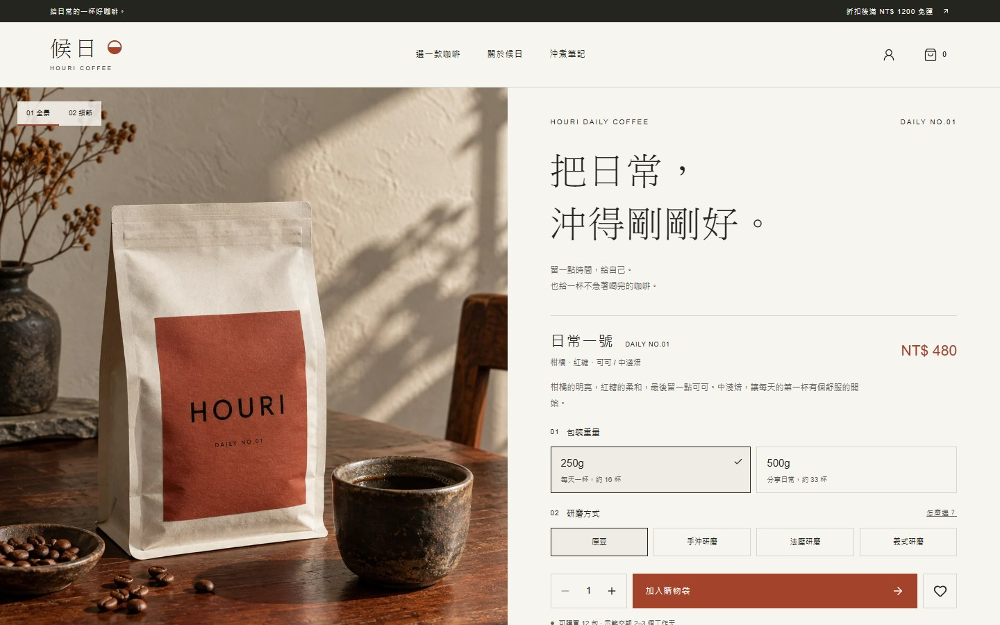
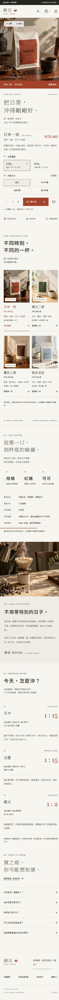
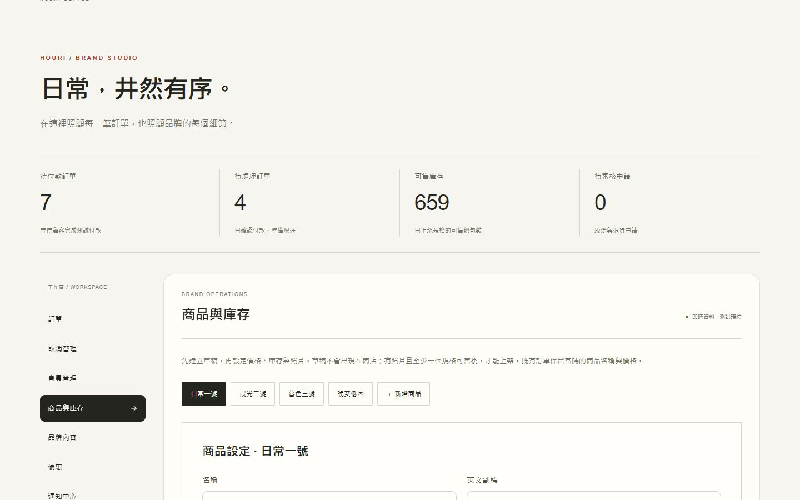
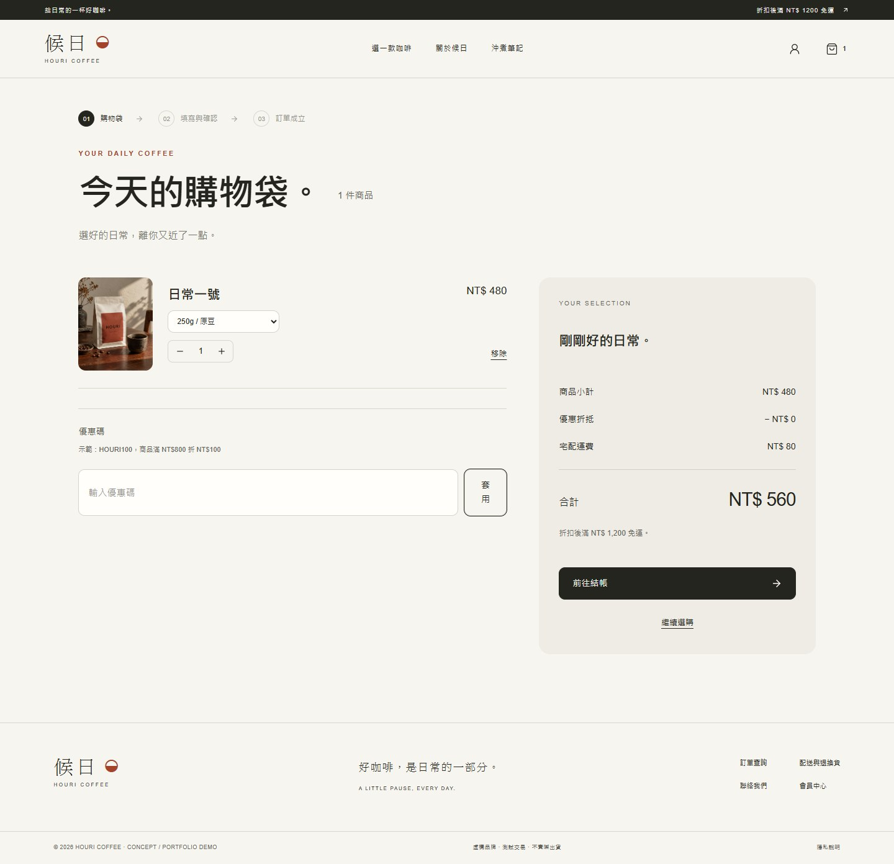
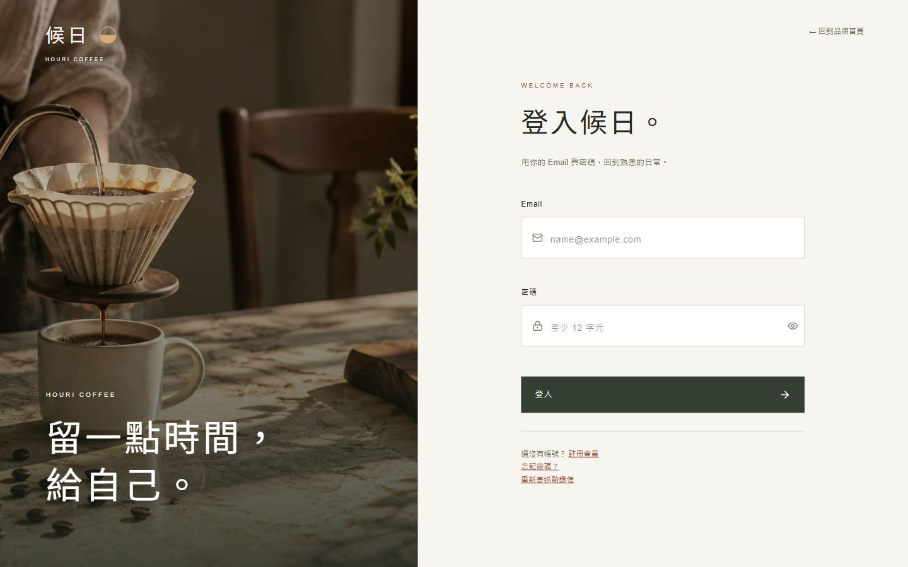

# 候日 HOURI

### 咖啡品牌購物網站

全端電商作品 · 品牌視覺 · 會員購物 · 店家工作台

候日是以日常咖啡為題的品牌概念作品。我把品牌介紹、商品選購、會員訂單與店家營運流程做成同一個網站，讓訪客可以從認識商品一路走到結帳體驗，店家則能管理商品、庫存與履約進度。

**[查看線上展示](https://houri-coffee-store.stonyant1.chatgpt.site/)** · 網站公開瀏覽，註冊與結帳需要會員帳號。交易不會正式扣款或出貨，請勿輸入真實付款資料。

> 此公開儲存庫只放作品介紹與去識別化介面截圖，**不包含應用程式原始碼、資料庫、部署設定或測試帳號**。完整程式碼存於私人儲存庫。

## 作品目標

- **顧客**：瀏覽咖啡、選擇重量與研磨方式、加入購物袋、管理常用地址，查詢訂單及各階段進度。
- **員工**：處理訂單、取消申請與會員服務，依權限查看工作所需資料。
- **擁有者**：管理商品、SKU、庫存、品牌標語、員工權限與通知設定，並查看營運紀錄。

## 介面展示

### 品牌與商品選購

首頁以咖啡商品攝影、留白與溫暖色調呈現品牌。商品可選不同包裝重量和研磨方式；價格與可用庫存由對應 SKU 決定。

### 店家商品與庫存工作台

擁有者可建立商品草稿、增加規格、設定價格與庫存，並調整品牌文字。未上架或售罄的規格不提供購買。

### 購物袋與會員登入

購物袋可調整規格、數量及優惠碼，結帳金額由伺服器重新計算。網站公開可看；建立訂單前須登入會員。

## 核心流程

1. 顧客選擇商品規格，加入個人購物袋。
2. 會員確認收件資料並建立訂單；系統保留庫存。
3. 金流服務回報付款結果，後端驗證交易並更新訂單。
4. 店家依序處理備貨、配送與完成；顧客可在訂單頁查看進度並接收 Email。
5. 逾期未付款或核准取消時，系統按規則釋放保留庫存。

## 技術與驗收

| 面向 | 實作內容 |
| --- | --- |
| 前端 | TypeScript、React 19、Vinext／Vite、響應式介面與互動效果 |
| 後端 | Cloudflare Workers、角色權限、伺服器端價格與庫存驗證 |
| 資料 | D1／Drizzle、R2 商品圖片、訂單與庫存紀錄 |
| 整合 | 綠界 stage 金流串接、Email 通知、店家 Telegram 通知 |
| 驗證 | 型別檢查、零警告 lint、65 項自動測試、建置及線上角色／交易流程檢查 |

**作品界線：** 綠界 stage 不會實際扣款；簡訊實收、正式退款、正式金流對帳與出貨營運尚未啟用。公開展示的程式架構與流程是作品實作，不代表已完成正式商用驗收。
